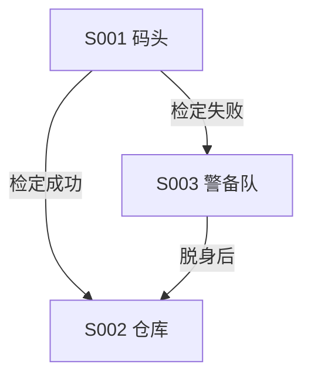

# 章节、白板与主持CG

这是本技能的核心。CG 写得好不好，决定你现场能不能不慌。

## 文字流程与主持 CG

每章文字流程和主持 CG 共用总索引的 S 编号，按同编号互相引用。两份可以同步草拟。非线性探索保留原文支持的入口、分支和回流。

场景事实与数值要能回查总索引记录的原文来源。根据原文支持的成功、失败、拒绝、漏线索、状态变化和转场路径准备需要的口播版本；未发生的结果只放主持人备注，不能预先写成玩家已知事实。用户只要求处理部分章节时，仅同步该部分及其受影响的索引与引用。

文字流程按 S 条目整理地图位置、可选行动、检定、任务、线索、遭遇、奖励和后续分支。原文没说明的分支标「未说明」，可选建议单独标注。

### 场景路线

在文字流程开头放 Mermaid 流程图或 Markdown 缩进大纲。每个节点写 S 编号和场景名，转场写触发条件。检定数值和后果以 S 条目的正文为准。分支汇合时引用同一个 S 编号。



缩进大纲可以写成这样。

- S001 码头
  - 检定成功 → S002 仓库
  - 检定失败 → S003 警备队
    - 脱身后 → S002 仓库

用户需要 Canvas 时，用已安装且支持该格式的工具转换，再核对排版、边端点、分支标签和对应场景的导航。工具缺失时，将文字路线留作后续转换的输入。接管时保留现有白板的手工布局与内容；继续使用的白板和文字流程、主持 CG 按同一个 S 编号两两互链。白板文字节点以【S001 场景名】为首行标题。

### 场景速查

在用得到的 S 条目内写一两行主持速查，带 NPC 或怪物编号、名称和此刻需要的行动信息。完整数值以对应数据条目为准。需要展开时可用 `![[资料文件#^块编号]]` 嵌入已经标记的主持速查段，另保留指向 N/M 数据标题的导航。

- NPC · N001 港务官哈维尔 · 守在栈桥入口，认出账页后要求私下交谈。[[雾港 NPC数据#N001 港务官哈维尔|数据]]
- 怪物 · M001 礁石食尸鬼 · 从木桩后接近，沿码头边缘追击。[[雾港 怪物数据#M001 礁石食尸鬼|数据]] · [[雾港 怪物描述#M001 礁石食尸鬼|描述]]

## 每个 S 节点的 CG

H1 带模组名、章名、【主持CG】。H2 写【S001 实际场景名】。H3 带该场景名与用途。逐节点写三段：

### 1 触发条件

什么时候可以念，玩家此刻已经能观察到或已经知道什么。条件没满足就不能提前用。写成可判断的句子：「玩家进入码头范围，且未触发过 S002」。

### 2 可直接朗读正文

常规场景 1—3 个短段，呈现**空间、光照、声音／气味、显眼物件、在场角色、正在发生的事**。关键节点充分展开，过渡可以简短。不能只有标题、提纲或一句总结。

用引用块区分朗读段落：

```markdown
> 码头比想象中安静。潮水拍着木桩，一下，又一下。
> 三盏风灯挂在栈桥尽头，其中一盏已经灭了。灯下堆着几只没封口的木箱。
> 一个披粗呢斗篷的人背对着你们，正在往水里放什么东西。
```

规矩：

- **只写玩家此刻能看到的**。不给性格判断，不写心理活动，不预告尚未发生的结果。
- **不替玩家做选择、不指定感受**。「你们感到一阵恐惧」不行，「后颈的汗毛立起来」可以——后者是可观察的身体反应。
- **朗读句不超过 40 字，一段不超过三句**。超了断句，但不改事实顺序。
- 关键节点写**条件版本**：昼夜、潮位、已获线索、角色形态会改变可见场景时，各写一段，标明条件。

### 3 主持人备注

不朗读。写检定 DC、隐藏真相、战术、额外条件、结果选择、来源、双向导航。

## 「表达层」到底能写什么

第四条硬规则允许你写原文没有的**文字**，但只限可观察的感官层。判据很简单：**这句话是不是在陈述一个可以被看见、听见、闻到、摸到的事实？**

| 可以写 | 不能写 |
| --- | --- |
| 光线从哪来、照到哪里、影子什么样 | 「这个房间曾经是刑讯室」——原文没说的历史 |
| 声音的方向、远近、节奏 | 「他知道你们来了」——角色的内心状态 |
| 气味的具体来源与浓淡 | 「箱子里的东西值三百金币」——未公开的信息 |
| 材质、温度、湿度、脚下的触感 | 「他其实是被胁迫的」——动机 |
| 在场角色的动作、姿态、位置 | 「他抽出匕首准备偷袭」——尚未发生的结果 |
| 显眼物件的形状、磨损、摆放 | 「这是议会的密令」——未经检定可得的真相 |

分不清就问自己：**玩家现在就能看到吗？** 能，写；不能，要么删，要么放进主持人备注。

## 常见失误

- **描述变成说明**。「房间很阴森」是判断，「墙皮起了泡，地上积着一层黑水」是描写。
- **提前发牌**。把秘密写进朗读段，玩家还没调查就全知道了。
- **一段塞太多**。玩家记不住六个细节，挑三个最显眼的。
- **没有地面**。只有形容词没有具体物件，玩家不知道该摸哪里。
- **口播和 CG 不一致**。白板上写着 S003 在钟楼，CG 里却写成码头。

## 交付前自查

每个 S 节点问四句：

1. 玩家不做任何事，也能从这段里看到三样具体东西吗？
2. 有没有一句话在替玩家决定感受或行动？
3. 有没有一句话泄露了只有检定成功才能知道的事？
4. 最长的那句，念出来会喘不上气吗？
